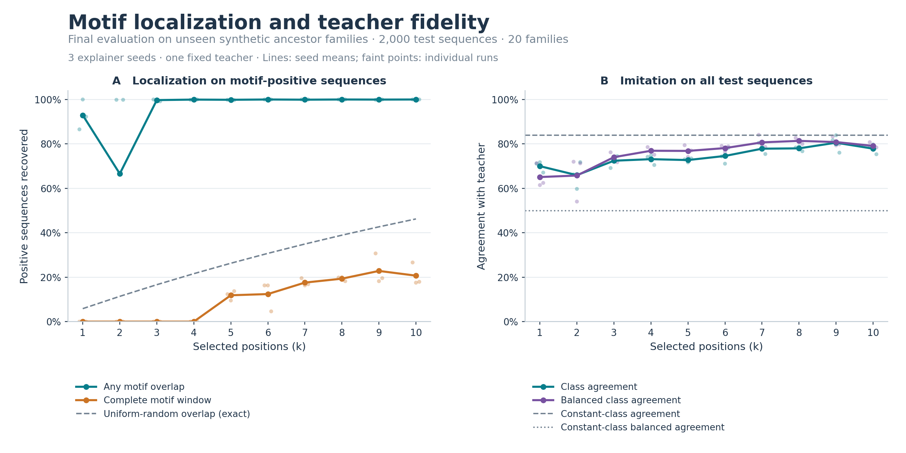
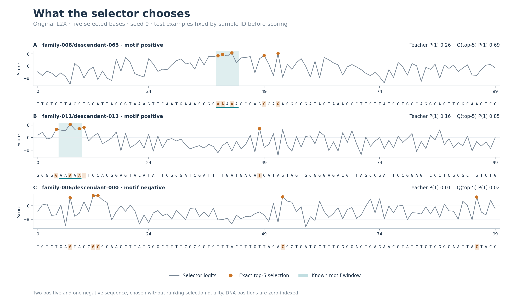

# L2X for DNA Motif Interpretation

A research project adapting **Learning to Explain (L2X)** to synthetic DNA. A convolutional selector chooses sequence positions, and an auxiliary predictor tries to reproduce a PyTorch teacher’s probabilities from those positions.

**Finding:** the selector reliably finds part of the known motif, but that does not guarantee a faithful explanation of the teacher. The project investigates this distinction through family-held-out evaluation, probability and class-level metrics, and a controlled comparison of soft versus hard training masks.

Developed by **Lillian Wang**, with mentorship from **Dillon Lue in the Pritykin lab at Princeton University**.



## Results

The dataset contains 10,000 synthetic 100-base sequences labeled by the presence of `AAAAA`. Entire ancestor families are separated into training, validation, and test partitions (60/20/20 families), preventing related descendants from crossing partitions.

The table reports the **original L2X model at k=5** on 2,000 test sequences from 20 unseen families. Five bases matches the known motif length; all ten feature budgets and all three seeds are retained in the [full evaluation](results/final_evaluation.json).

| Test metric | Mean ± sample SD | Baseline |
| --- | ---: | ---: |
| Any motif overlap, positive sequences | **99.86% ± 0.14** | 26.29% uniform-random selection |
| Complete five-base motif recovery, positive sequences | **11.87% ± 2.15** | — |
| Class agreement with teacher | **72.73% ± 0.92** | 83.90% constant-negative prediction |
| Balanced class agreement with teacher | **76.85% ± 2.67** | 50.00% constant prediction |

Overlap and complete recovery use the 736 motif-positive test sequences. Agreement uses all 2,000 sequences. SDs describe three explainer seeds with one fixed teacher; they are not confidence intervals. The teacher achieves 68.50% accuracy against synthetic labels and 0.705 AUROC, compared with 63.20% accuracy for the training-label-majority baseline.

The constant-negative predictor’s high agreement reflects the teacher’s class imbalance: it misses every teacher-positive example. Balanced agreement makes that limitation visible. Even with useful minority-class recovery, the explainer’s probability errors and incomplete motif recovery limit the fidelity claim.

### A controlled test of the mask mismatch

L2X trains with relaxed, stochastic masks and evaluates with binary top-k masks. To test this mismatch, both continuation arms start from identical saved predictor weights and receive the same training batches for 15 additional epochs. The teacher and selectors stay fixed. Both arms are evaluated with exact top-5 masks.

| Partition | Soft-training KL ↓ | Hard-training KL ↓ | Soft-training balanced agreement | Hard-training balanced agreement |
| --- | ---: | ---: | ---: | ---: |
| Validation | 0.3583 | 0.2786 | 72.67% | 70.30% |
| Test | 0.3365 | 0.2686 | 77.89% | 78.93% |

Hard-mask training reduces mean test KL by **20.2%** relative to the equal-budget soft-mask control. Test class agreement rises from 73.08% to 75.17%. Validation balanced agreement decreases, illustrating a class-specific tradeoff; mask alignment does not eliminate the generalization gap.

[Paired comparison figure](figures/mask_comparison.png) · [Per-seed results and protocol](results/final_evaluation.json) · [Metric definitions and limitations](docs/methods.md)

## Inspecting individual selections

The examples below were fixed by sample ID before test scoring: two positive sequences and one negative, using the original k=5, seed-0 model. Orange marks selected bases; teal marks true motif windows. The positive examples show partial localization alongside disagreement between the teacher and the masked-input predictor.



All three figures are included as PNGs and [PDFs](figures/), with a [figure provenance manifest](figures/manifest.json).

## Contributions and attribution

My mentor supplied the synthetic generator (`simulation.py`) and PyTorch teacher (`train.py`). My work adapted the L2X workflow to DNA through a convolutional position selector, a custom Keras Concrete-sampling layer, aligned PyTorch-to-Keras prediction exports, and selection/fidelity diagnostics. The evaluation includes sample and family identities, a shared family split, checked artifacts, and matched mask-training controls.

The method builds on [Chen, Song, Wainwright, and Jordan (2018)](https://proceedings.mlr.press/v80/chen18j.html) and the [original L2X implementation](https://github.com/Jianbo-Lab/L2X).

## Reproduce

Validated on **Python 3.10, macOS arm64, CPU**. Direct dependencies and a complete environment snapshot are provided in `requirements.txt` and `requirements-lock-macos-arm64-py310.txt`.

```bash
python3.10 -m venv .venv
source .venv/bin/activate
python -m pip install -r requirements.txt
export KERAS_BACKEND=tensorflow
export OMP_NUM_THREADS=2 TF_NUM_INTRAOP_THREADS=2 TF_NUM_INTEROP_THREADS=2
```

Rebuild the included figures from recorded results, without training models:

```bash
python plot_results.py
```

Run the complete pipeline from this directory:

```bash
python data_contract.py --seed 42
python run_advisor_training.py --out_dir outputs/teacher --seed 0 --epochs 10
python run_diagnostics.py --out_dir outputs/fidelity --max_k 10 --n_seeds 3 --epochs 15
python compare_mask_training.py --out_dir outputs/mask_comparison --k 5 --seeds 0 1 2 --epochs 15

python evaluate_saved.py --protocol outputs/reproduction_protocol.json --lock_protocol
python evaluate_saved.py --protocol outputs/reproduction_protocol.json --output outputs/reproduction_evaluation.json
python plot_results.py --input outputs/reproduction_evaluation.json --out_dir outputs/reproduction_figures
```

Training commands protect existing experiment directories. The checked-in [evaluation protocol](results/evaluation_protocol.json) identifies the reported run; a reproduction creates its own protocol to bind its own checkpoint files. Large generated arrays and models stay in ignored `outputs/`; measured results and figures are included in the repository.

```bash
python -m unittest discover -s tests -v
```

The 42 checks cover diagnostic known answers, family and row identity, prediction alignment, frozen-selector controls, and inference-only final evaluation. Small pipeline fixtures test software behavior rather than scientific performance.

## Code guide

| File | Purpose |
| --- | --- |
| `simulation.py`, `train.py` | Mentor-supplied simulator and teacher, with identity metadata and shared-pipeline integration |
| `run_advisor_training.py` | Teacher training and verified probability export |
| `dna_l2x.py` | DNA selector, relaxed sampler, and prediction approximator |
| `data_contract.py`, `validation_checks.py` | Family split, checked artifacts, and localization metrics |
| `run_diagnostics.py`, `compare_mask_training.py` | Feature-budget sweep and matched mask-training control |
| `evaluate_saved.py`, `plot_results.py` | Locked evaluation and figures from recorded results |

This is a synthetic feature-selection study. It does not establish biological causality or transfer to experimental DNA. [Methods and limitations](docs/methods.md) describe the teacher’s limitations, soft/hard mask differences, and interpretation of removal diagnostics.
